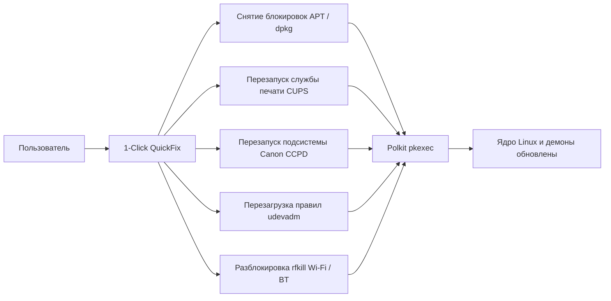

<div align="center">


# DriverHub Linux

### Профессиональный менеджер оборудования, драйверов и модулей ядра

[](https://github.com/giddammit-crypto/driverhub)
[](https://electronjs.org/)
[](https://github.com/giddammit-crypto/driverhub)
[](https://github.com/giddammit-crypto/driverhub)
[](LICENSE)

<p align="center">
  <b>DriverHub</b> — высоконадёжное инженерное приложение для комплексной инспекции аппаратного обеспечения, автоматической настройки драйверов, устранения системных сбоев ядра и управления службами печати в <b>Astra Linux (Special & Common Edition)</b>, <b>Debian</b> и <b>Ubuntu</b>.
</p>

[Возможности](#-ключевые-возможности) • [Canon LBP Suite](#-комплекс-печати-canon-lbp-для-astra-linux) • [1-Click QuickFix](#-матрица-экспресс-восстановления-1-click-quickfix) • [ИИ-Агент](#-интеллектуальный-ассистент-qwen-ai) • [Установка](#-установка-и-запуск) • [Сборка .DEB](#-сборка-системного-deb-пакета) • [Безопасность](#-архитектура-и-безопасность)

---

</div>

## 🌟 Ключевые возможности

* 🔍 **Глубокое сканирование шин PCI & USB с Sysfs-Fallback:**
  * Извлечение активных драйверов ядра (`Kernel driver in use`, `lsusb -t` интерфейсное дерево).
  * Встроенный резервный механизм **нативного чтения `/sys/bus/pci` и `/sys/bus/usb`** — приложение работает даже на минимальных образах ОС без установленных `pciutils` и `usbutils`.
  * Интеллектуальный анализ составных (Composite) USB-устройств: Wi-Fi/Bluetooth комбо-чипы (AICSemi AIC8800, Realtek, MediaTek) безошибочно определяются как сетевые интерфейсы, а системные PCI-мосты не помечаются ложными ошибками.

* 🏷️ **Интерактивная фильтрация каталога оборудования:**
  * Удобные фильтр-чипы с живым счётчиком: `Все`, `Видеокарты`, `Сеть и Wi-Fi`, `Звук`, `Принтеры`, `Bluetooth`, `Накопители`, `Ввод / USB`.
  * Фильтрация по статусам (*Все*, *Требуют внимания / Драйвер*, *Работают корректно*) и мгновенный поиск в реальном времени.

* 🖶 **Специализированный комплекс печати Canon LBP (Astra Linux & Debian):**
  * Автоматическое конфигурирование принтеров серии Canon Laser Shot / i-SENSYS на базе протокола CAPT.
  * Автоматическое исправление прав групп `lp`/`lpadmin` (решение типичной проблемы Astra Linux, когда задания виснут в очереди).
  * Печать фирменной векторной тестовой страницы A4 со сверхэкономичным чистым белым фоном (нулевой расход тонера).

* ⚡ **Матрица экспресс-восстановления 1-Click QuickFix:**
  * Мгновенное устранение блокировок пакетов APT/dpkg (`/var/lib/dpkg/lock`).
  * Перезапуск служб CUPS и CCPD.
  * Перезагрузка правил udev (`udevadm trigger`) и разблокировка радиомодулей (`rfkill unblock`).

* 📊 **Экспорт полного диагностического отчёта:**
  * Формирование подробного технического отчёта (ОС, ядро, Wayland/X11, PipeWire/PulseAudio/ALSA, процессор, ОЗУ, аптайм, таблица всех устройств и журнал операций).
  * Однокликовое копирование в буфер обмена или сохранение в файл `~/driverhub-report.md`.

* 🧠 **Системный ИИ-Агент на базе бесплатных моделей Qwen:**
  * Прямая интеграция с xkiro API (модели `qwen/qwen3.8-max:free`, `qwen/qwen-2.5-coder-32b-instruct:free`, `qwen/qwen2.5-vl-72b-instruct:free` и др.).
  * Интерактивный чат с анализом системной телеметрии и предложением пошаговых планов исправления.

* 📥 **Реальное скачивание с индикацией прогресса:**
  * Визуальное отслеживание скорости загрузки (МБ/с), ETA и объёма скачанных данных в режиме реального времени.

---

## 🖶 Комплекс печати Canon LBP для Astra Linux

Принтеры серии Canon CAPT (LBP) традиционно вызывают затруднения в Astra Linux и Debian из-за конфликта стандартного модуля ядра `usblp`, закрытого протокола управления CCPD и разграничения доступа к символьным устройствам `/dev/usb/lp*`. 

DriverHub решает эти проблемы «из коробки»:

| Модель принтера | Драйвер / PPD | Подсистема | Режим Astra Linux |
| :--- | :--- | :--- | :--- |
| **Canon LBP2900 / LBP2900B** | `CNCUPSLBP2900CAPTK.ppd` | CAPT / CCPD | Автоматическая привязка к `/dev/usb/lp0` |
| **Canon LBP3000** | `CNCUPSLBP3000CAPTK.ppd` | CAPT / CCPD | Регистрация службы `ccpd.service` |
| **Canon LBP3010 / LBP3018 / LBP3050** | `CNCUPSLBP3050CAPTK.ppd` | CAPT / CCPD | Настройка FIFO буфера `/var/ccpd/fifo0` |
| **Canon LBP6000 / LBP6018** | `CNCUPSLBP6018CAPTK.ppd` | CAPT / CCPD | Автоматическое исправление групп `lp/lpadmin` |
| **Canon LBP6020 / LBP6020B** | `CNCUPSLBP6020CAPTK.ppd` | CAPT / CCPD | Udev-правила с правами `0660` |
| **Canon LBP6200 / LBP6300 / LBP7018C** | Соответствующие PPD | CAPT / CCPD | Полная поддержка очередей CUPS |

### Фирменная тестовая страница DRIVER HUB LINUX
Приложение генерирует калиброванную тестовую страницу PostScript/PDF:
* **100% чистый белый фон** — исключён расход чернил или тонера на заливку фона.
* Фирменная векторная сетка, шкала градиентов серого и CMYK, круговые мишени сведения геометрии.
* Полный технический блок с версией ядра, хостом, датой и дистрибутивом.

---

## 🛠 Матрица экспресс-восстановления (1-Click QuickFix)

В разделе **«Исправление ошибок»** доступно выполнение системных восстановительных процедур в один клик:



---

## 🤖 Интеллектуальный ассистент Qwen AI

DriverHub содержит встроенного ИИ-агента, оптимизированного для администрирования Linux. Агент анализирует журнал `dmesg`, конфигурацию шин PCI/USB и состояние очередей печати:

* **Интеграция:** Поддержка провайдера **xkiro API** (`https://api.xkiro.com/v1`).
* **Бесплатные модели по умолчанию:**
  * `qwen/qwen3.8-max:free`
  * `qwen/qwen-2.5-coder-32b-instruct:free`
  * `qwen/qwen2.5-vl-72b-instruct:free`
* **Автоматические планы действий:** Агент не просто консультирует, а формирует интерактивные кнопки утверждения для безопасного применения настроек.

---

## 🚀 Установка и запуск

### Запуск из исходного кода

```bash
# 1. Клонирование репозитория
git clone https://github.com/giddammit-crypto/driverhub.git
cd driverhub

# 2. Установка зависимостей
npm install

# 3. Синтаксическая проверка и тесты
npm run check
npm test

# 4. Запуск приложения
npm start
```

> **Примечание для Debian 13+, Ubuntu 24.04+ и Astra Linux:**  
> Из-за ограничений непривилегированных пространств имён ядра (`unprivileged_userns_clone`) запуск Electron настроен со встроенным параметром безопасности `--no-sandbox`.

---

## 📦 Сборка системного .DEB пакета

В репозиторий включён полностью автоматизированный скрипт сборки нативного установочного пакета для Astra Linux, Debian и Ubuntu:

```bash
npm run build:deb
```

Скрипт формирует готовый пакет в каталоге `dist/driverhub_1.0.0_amd64.deb`, включающий:
* Исполняемые файлы приложения в `/opt/driverhub`.
* Zero-chmod лаунчер `/usr/bin/driverhub`.
* Ярлык рабочего стола `/usr/share/applications/driverhub.desktop` с иконкой высокой чёткости.
* Политики привилегий Polkit `/usr/share/polkit-1/actions/ru.biblioteka33.driverhub.policy`.
* Скрипт `postinst` для автоматической регистрации прав на запуск.

Установка собранного пакета в системе:
```bash
sudo dpkg -i dist/driverhub_1.0.0_amd64.deb
sudo apt-get install -f   # автоматическое разрешение зависимостей при необходимости
```

---

## 🛡️ Архитектура и безопасность

DriverHub спроектирован с соблюдением корпоративных стандартов безопасности:

1. **Изоляция контекста (Context Isolation & Sandbox):**  
   Интерфейс рендерера полностью изолирован от Node.js API (`contextIsolation: true`, `sandbox: true`, `nodeIntegration: false`). Связь осуществляется исключительно через типизированный безопасный мост `preload.cjs`.
2. **Строгая Политика Безопасности Контента (CSP):**  
   Заголовок CSP блокирует выполнение любого стороннего кода, скриптов с непроверенных доменов или eval:
   ```html
   default-src 'self'; style-src 'self' 'unsafe-inline'; script-src 'self'; img-src 'self' data:; connect-src 'self';
   ```
3. **Безопасная модель Polkit (Allowlist):**  
   Установка драйверов и управление службами выполняются через системный `pkexec` с обязательной проверкой пакетов по строгой белой карте (`ALLOWED_PACKAGES`). Выполнение произвольных команд или shell-инъекции технически исключены.
4. **Неинтерактивные таймауты APT:**  
   Все системные вызовы пакетов снабжены параметрами `-o DPkg::Lock::Timeout=60`, `--force-confdef`, `--force-confold` и `DEBIAN_FRONTEND=noninteractive`, что исключает зависание процессов при возникновении диалоговых окон в терминале.

---

## 📊 Структура проекта

```
driverhub/
├── src/
│   ├── main.cjs              # Главный процесс Electron, аппаратное сканирование, sysfs, IPC
│   ├── preload.cjs           # Безопасный мост contextBridge
│   ├── canon-lbp-setup.cjs   # Комплекс настройки принтеров Canon CAPT LBP
│   ├── installer.cjs         # Потоковая загрузка, проверка allowlist и интеграция с pkexec
│   ├── agent-engine.cjs      # Движок ИИ-Агента, xkiro API и планы действий
│   ├── assets/icons/         # Векторные и растровые иконки высокого разрешения
│   └── renderer/
│       ├── index.html        # Каркас интерфейса со строгой политикой CSP
│       ├── styles.css        # Дизайн-система DriverHub Dark Theme
│       └── app.js            # Логика интерфейса, фильтры, QuickFix, чат агента
├── scripts/
│   └── build-deb.cjs         # Генератор системных .deb пакетов
├── test/
│   └── application.test.cjs  # Комплексный набор unit и интеграционных тестов (22 теста)
├── package.json
└── README.md
```

---

## 🧪 Тестирование

Комплексный автоматический тестовый набор проверяет целостность политик безопасности, корректность генерации конфигураций PPD/systemd/udev, парсеры AI и сканирование оборудования:

```bash
$ npm test

✔ Electron security boundary is present
✔ interface includes all DriverHub sections from the design
✔ driver installation is restricted to a package allowlist
✔ renderer defines a strict Content Security Policy
✔ main process configures linux sandbox compatibility and safe hardware scanning
✔ pkexec execution uses noninteractive APT options, lock timeout, and isolated env
✔ main process restricts window opening, navigation and permissions
✔ renderer performs incremental DOM search and safe settings handling
✔ Canon LBP suite generates valid PPDs, module configurations, udev rules and systemd service
✔ Visual installation progress tracking and package download streaming are supported
✔ xkiro API configuration and free Qwen models selection are fully integrated
✔ AI Agent operates with system telemetry and executable action plans
✔ Astra Linux Canon LBP printing diagnostics detects missing lp group and offers one-click fix
✔ Application ensures full UI responsiveness and persistent settings synchronization
✔ BrandKit vector icons and adaptive diagnostic & repair dashboard are fully integrated
✔ CUPS printer management and branded test page (DRIVER HUB LINUX / biblioteka33.ru) are integrated
✔ Reboot warning dialog and pending reboot telemetry are integrated
✔ Debian installer build script and zero-chmod launcher are configured
✔ AI diagnostic output formatting safely parses raw and partial JSON
✔ Hardware diagnostic report generation produces detailed Markdown and includes telemetry, devices and checks
✔ Composite USB device categorization and sysfs fallback scanning are supported
✔ Interactive category filter chips, status filtering, and 1-Click QuickFix matrix are integrated
ℹ tests 22, pass 22, fail 0
```

---

## 📄 Лицензия

Проект распространяется под открытой лицензией **MIT License**. Подробности в файле [LICENSE](LICENSE).

<div align="center">
  <sub>Разработано для стабильной и комфортной работы пользователей и системных администраторов Linux.</sub>
</div>
